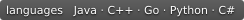

 

# Hello Design Patterns

  
  
  
  

设计模式指南 · [在线阅读](https://cuihairu.github.io/hello-design-patterns/) · [English](./README.md)

---

这里记录个人学习笔记、心得与经验，以游戏开发者的视角分享创建型、结构型、行为型、并发等设计模式，以及集成模式、反模式和现代设计实践；示例涉及 C++、Java、Go。

> 📖 English version see [README.md](./README.md)

调研产出收拢：[知识点整理](https://cuihairu.github.io/hello-design-patterns/knowledge.html) —— 核心概念、书籍与官方文档要点、应用场景与常见坑。

## 开发

本站使用 [VitePress](https://vitepress.dev/) 构建。[VitePress 侧栏](./docs/.vitepress/config.mts)是唯一权威导航源；新增或移动页面时更新侧栏，不另维护手写页面清单。`npm run docs:audit` 核对侧栏、站内链接、页面标题与各分区索引是否与磁盘文件一致；`npm run docs:build` 兜底死链。

## License

本作品采用 [Creative Commons Attribution 4.0 International (CC BY 4.0)](https://creativecommons.org/licenses/by/4.0/) 许可协议发布。
